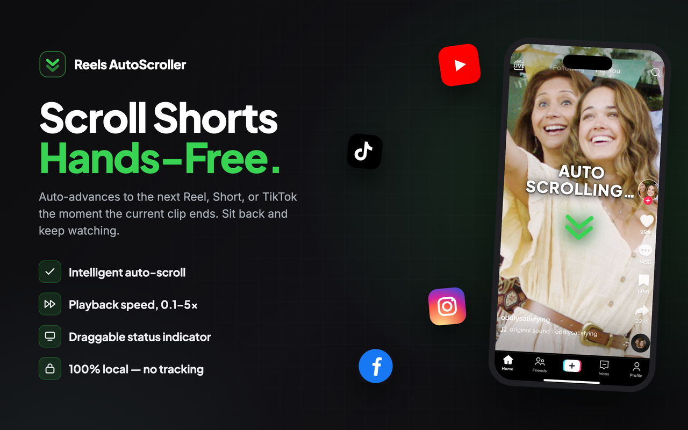
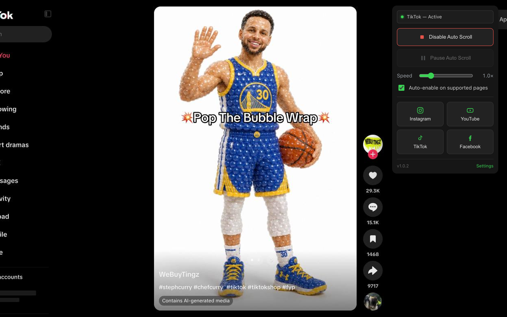
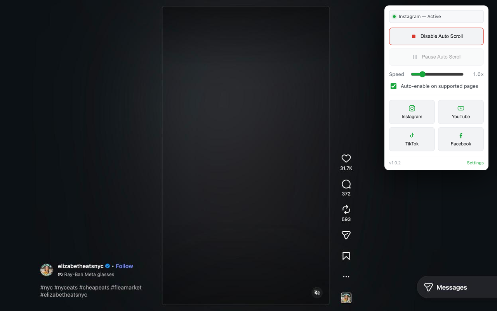
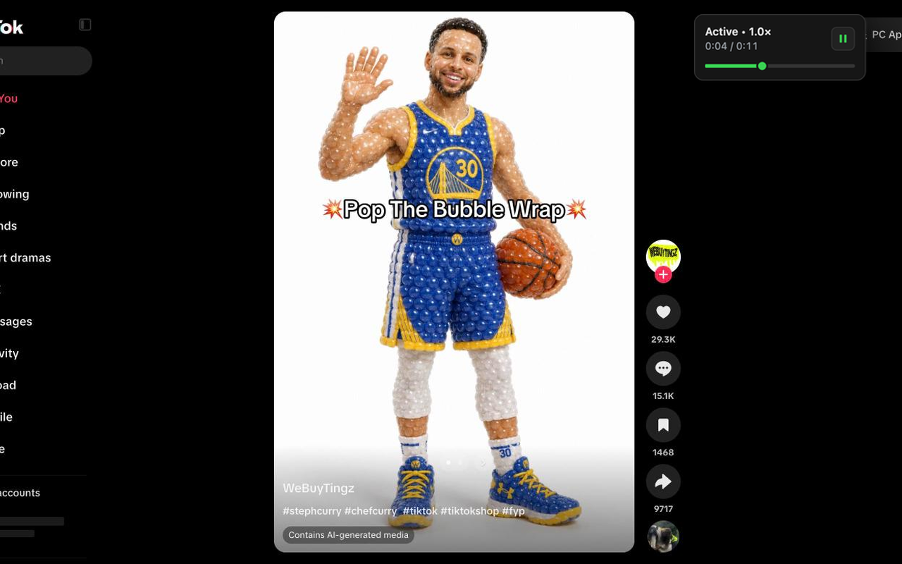

# Reels AutoScroller

   

<!-- TODO: update the href with the published listing URL after the first Chrome Web Store release -->

  

  

  
  
  

A fast, minimal, **open-source** Chrome extension for hands-free short-form video. When a clip ends, Reels AutoScroller advances to the next one for you — on **Instagram Reels**, **YouTube Shorts**, **TikTok** and **Facebook Reels**. 100% local: no account, no cloud, no tracking.

## Features
- **Auto-advance** when a video ends, with a layered per-platform strategy (scroll container → `ArrowDown` → wheel → simulated swipe → window scroll) so it keeps working as each site's DOM changes
- **Playback speed** from 0.1× to 5×, from the popup or the keyboard
- **On-screen status HUD** — a draggable pill showing Active/Paused, the current video time and a seekable progress bar, with per-platform position presets
- **Keyboard shortcuts** — toggle · pause/resume · speed up/down · reset speed, all rebindable
- **Pause when comments are open** (optional), with hysteresis so a flicker in the page doesn't thrash the pause state
- **Auto-enable** on supported pages (optional)
- **Statistics** — per-platform scroll counts and total watch time, with export/import
- Light & dark themes and a custom accent color
- Nothing leaves your device — see [Permissions](#permissions)

## Install (unpacked)
1. Open `chrome://extensions` and enable **Developer mode**
2. **Load unpacked** → select this folder
3. Pin the Reels AutoScroller icon, open a supported feed, and click it (or press `Alt+T`)

## Permissions
- `storage` — remember your settings and statistics
- `tabs` — let the popup and settings page talk to your open feed tabs (toggle, pause, and push setting changes)
- host access to `instagram.com`, `youtube.com`, `tiktok.com` and `facebook.com` — run the content script that watches the video and advances the feed, only on those sites

## Development
There's no build step and nothing to install: Chrome runs the files in this folder as they are. After changing one, press the reload button on Reels AutoScroller's card in `chrome://extensions`.

Run the tests with `npm test`. They use Node's built-in test runner, live in `tests/`, and CI runs them on every push and pull request.

To publish, run `npm run package`. It builds `reels-autoscroller.zip` in this folder for upload to the Chrome Web Store. Pushing a change to `manifest.json` on `master` also auto-publishes via GitHub Actions (see [`.github/workflows/publish.yml`](.github/workflows/publish.yml)).

## License
[MIT](LICENSE) © John Pratt
